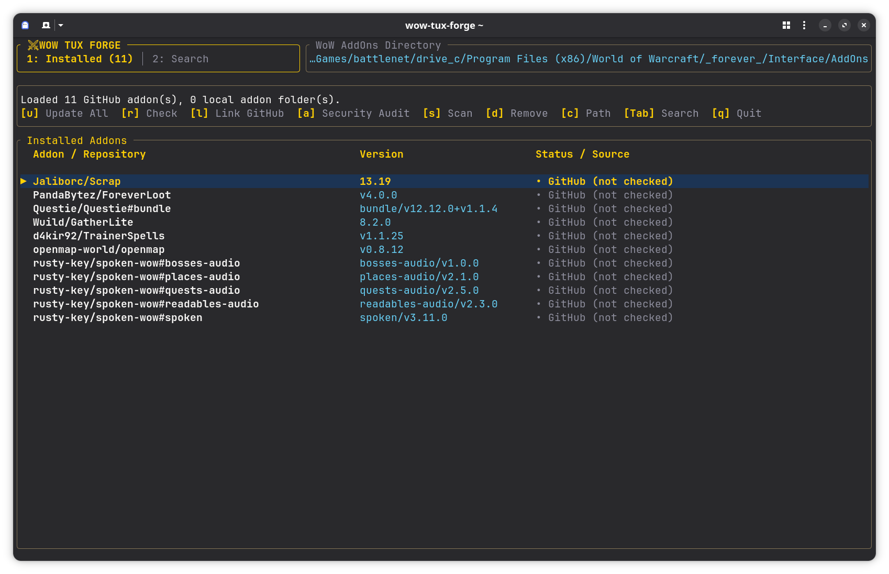
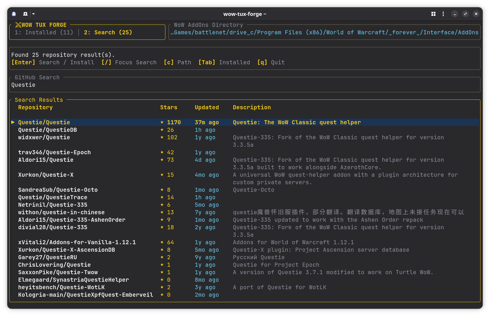

# wow-tux-forge

Terminal UI (TUI) manager for World of Warcraft addons hosted on GitHub.




## Features

- **GitHub-native:** Search repositories and install release `.zip` assets directly into your `Interface/AddOns` directory.
- **Updates:** Check for new releases and update all managed addons in one step.
- **Local addon linking:** Scan existing local addons and link them to their GitHub repos via `.toc` metadata.
- **Security audit:** Inspect downloaded archives and installed addon folders for executables and suspicious Lua patterns.

## Install

### Homebrew (Recommended)

```bash
brew tap pandabytez/tap && brew trust pandabytez/tap && brew install wow-tux-forge
```

### Cargo

```bash
cargo install --git https://github.com/PandaBytez/wow-tux-forge
```

Run `wow-tux-forge` and press `c` on first launch to set your WoW `Interface/AddOns` directory path.

## Keybindings

| Key | Action |
|---|---|
| `1` / `2` / `Tab` | Switch between **Installed** and **Search** tabs |
| `c` | Configure `AddOns` directory path |
| `j` / `k` / `↑` / `↓` | Navigate lists |
| `r` | Check for updates (Installed) |
| `u` | Update all outdated addons (Installed) |
| `l` | Link local addons from `.toc` GitHub URLs (Installed) |
| `a` | Security audit all addons (Installed) |
| `s` | Security audit selected addon (Installed) |
| `d` | Delete selected addon (Installed) |
| `Enter` / `i` | Install/reinstall selected addon (Search) or confirm |
| `/` | Focus search input (Search) |
| `q` | Quit |

## Data Locations

- Config: `~/.config/wow-tux-forge/config.json` (platform `dirs::config_dir`)
- State: `~/.local/share/wow-tux-forge/state.json` (platform `dirs::data_local_dir`)

## License

[GPL-3.0](LICENSE)
